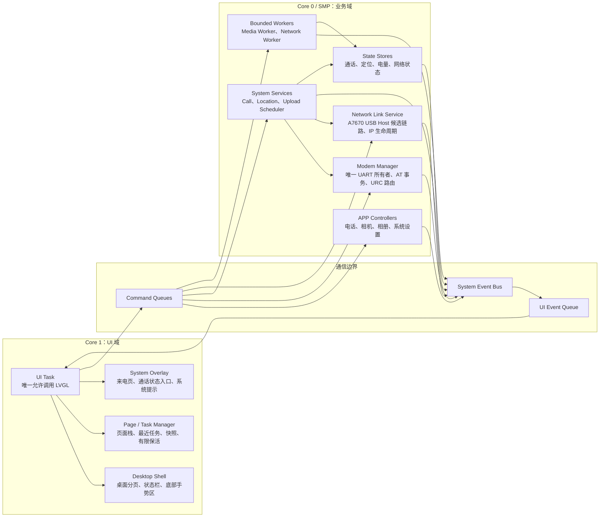
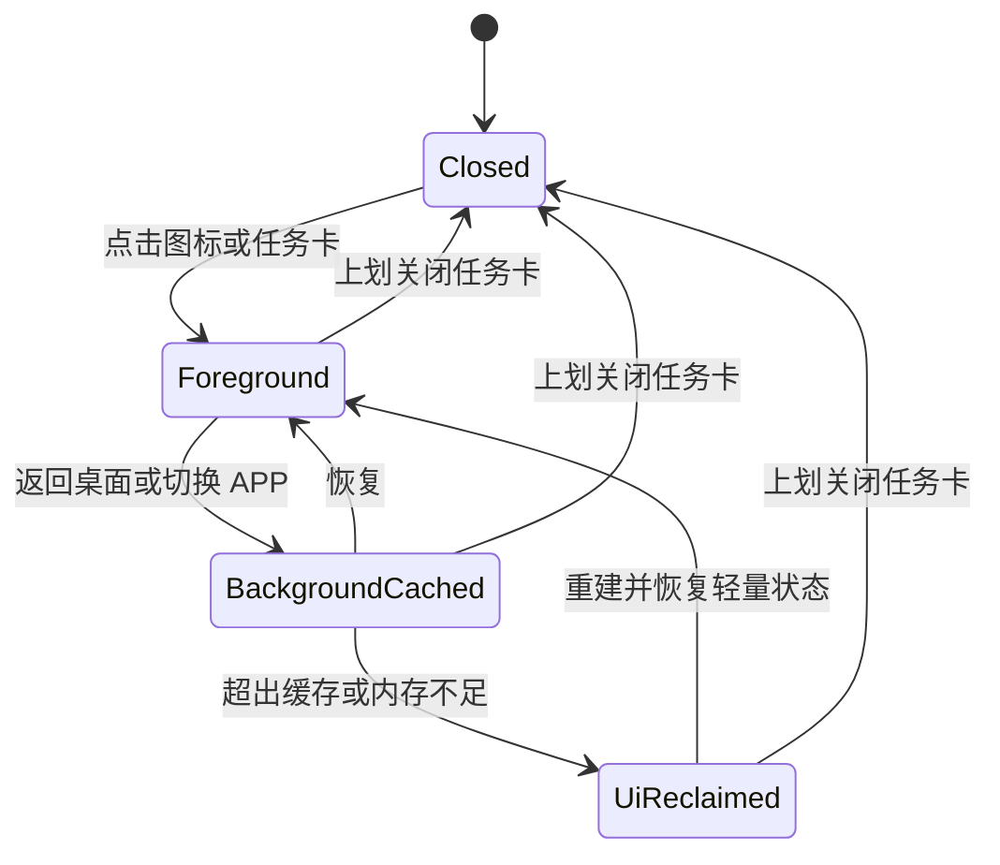
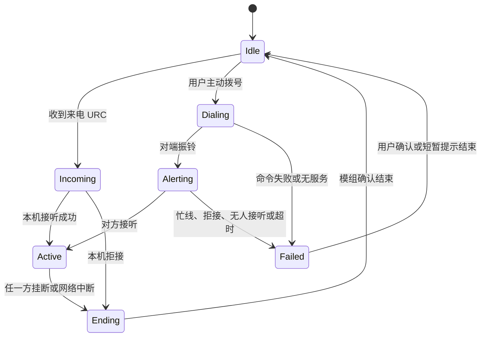

# 手持终端桌面与 APP 架构设计

本文是 [手持终端需求文档](../../需求.md) 的专项技术设计，覆盖桌面、APP 生命周期、系统服务、任务管理器和资源控制。产品范围、硬件接线和开发阶段以主需求为准。

## 已确认的运行架构

系统采用“APP 组件隔离、耗时工作按需多任务、LVGL 单线程渲染”的架构。



## 模块职责

### UI 域

- `UI Task`：处理触摸、手势、动画、LVGL 定时器以及 SPI DMA 刷新提交。
- `Desktop Shell`：管理多页桌面、图标、状态栏和底部系统手势区。
- `Page Manager`：管理当前页面、APP 内页面栈和系统覆盖层。
- `Task Manager`：管理最近 UI 会话、低分辨率快照和有限保活。
- `System Overlay`：显示全屏来电页、通话状态入口和系统错误提示。
- 只有 `UI Task` 可以创建、修改或删除 LVGL 对象。
- UI 域禁止等待 AT 响应、读取 TF 卡、解码 JPEG、采集摄像头或执行网络请求。

### APP 域

首批固件内置 APP：

- 电话
- 相机
- 相册
- 系统设置

设备身份和版本放在“系统设置 → 关于本机”中；运行时资源放在“系统设置 → 资源监控”中，不单独提供 APP。

每个 APP 拥有独立控制器和状态机，但不默认创建长期运行的 FreeRTOS 任务。耗时操作交给按需 Worker，界面更新通过事件队列交给 `UI Task`。

### 系统服务域

- 电话、定位上报和上传调度属于系统服务，不属于最近任务。
- `Modem Manager` 是 GPIO17/18 UART 的唯一所有者。其他模块不得直接调用 UART，只能提交结构化 AT 请求。
- `Modem Manager` 同一时间只执行一个 AT 事务，并负责超时、取消、迟到响应隔离以及命令响应与异步 URC 分流。
- AT 优先级为通话控制、关键网络状态、GNSS 查询、普通控制；来电和挂断 URC 不能被普通事务阻塞或丢弃。
- `Network Link Service` 优先通过 GPIO19/20 上的 A7670 USB 管理数据链路和 IP 生命周期。ESP32-S3 是 USB Host，阶段 0 必须先枚举 A7670 的实际 USB descriptors，确认 CDC-ACM 数据接口和 PPP/netif 适配可行；验证前不得把 USB PPP 当作已完成能力。
- 如果 USB Host 候选链路不能稳定取得 IP 或与 UART URC 并行，暂停依赖网络上传的后续实现，重新评审模组可支持的高速 UART 或其他数据接口。照片正文不得回退到 115200 UART 后仍宣称数秒级上传。
- 定位上报周期由系统设置配置，启用后持续循环，不因页面或任务卡关闭而停止。
- 电话 APP 的 UI 可以销毁，但正在进行的通话不能因此中断。
- 通话中移除电话任务卡后，桌面通话状态入口和电话图标都能重建统一通话页面。

### Worker 域

- 第一版不为每个请求动态创建 FreeRTOS 任务。
- `Media Worker` 使用固定任务和有界队列，串行执行摄像头采集、JPEG 处理、任务快照缩放和 TF 卡大块读写。
- `Network Worker` 使用固定任务和有界队列，串行执行 HTTPS 上传和下载；数据由阶段 0 已验证的 `Network Link Service` 承载。
- 队列满时，用户直接发起的操作返回“系统忙”；可合并的后台状态只保留最新任务，不允许队列无限增长。
- 来电或挂断时，Network Worker 按请求策略暂停或取消普通上传，并释放不再使用的缓冲和文件句柄。

## 已确认的交互

- 桌面支持多个固定布局页面，通过左右滑动切换。
- 点击图标打开对应 APP。
- 从屏幕底部持续上划进入任务管理器。
- 任务管理器使用低分辨率缩略快照卡片。
- 上划任务卡关闭对应 UI 会话；是否停止业务由 APP/服务策略决定。
- 点击底部导航条返回桌面。
- 来电时显示全屏系统来电页。
- 拒接后恢复来电前页面。
- 接听后进入电话 APP 的统一通话页面；主动拨号复用同一页面。

## APP 与页面生命周期

同时只有一个前台 APP。APP 的业务状态和 LVGL 页面对象分开保存，页面被回收后仍可根据轻量状态重建。



### 生命周期规则

- 第一版最多缓存一个后台 APP 的 LVGL 页面；完成相机、JPEG、快照和网络并发内存基准后，只有在满足内存安全线时才提高到两个。
- 最近任务最多保留四项，任务顺序按最近使用时间更新。
- 超出页面缓存上限或内存不足时，优先销毁最早进入后台的页面。
- 页面仍在缓存中时直接恢复；页面已回收时重新创建，并恢复轻量业务状态和 APP 内页面位置。
- 上划关闭任务卡会删除页面、快照和对应 UI 会话。
- 系统服务不属于 APP 生命周期，不会因关闭任务卡而停止。
- 每次打开或重建 APP 都生成新的会话编号；迟到事件的会话编号不匹配时直接丢弃。

APP 支持两种 UI 缓存策略：

- `CACHE_ALLOWED`：允许缓存页面，内存紧张时仍可回收并重建。
- `RECREATE_ON_RESUME`：退到后台后优先销毁页面，恢复时重新创建。

首批 APP 的默认策略：

| APP | UI 策略 | 后台能力 |
| :--- | :--- | :--- |
| 电话 | `CACHE_ALLOWED` | `Call Service` 独立常驻 |
| 相机 | `RECREATE_ON_RESUME` | 拍摄 Worker 按需运行 |
| 相册 | `CACHE_ALLOWED` | 文件读取和 JPEG 解码 Worker 按需运行 |
| 系统设置 | `CACHE_ALLOWED` | 配置保存到 NVS |
| 定位上报 | 不是 APP | `Location Service` 常驻 |

### APP 内页面栈

- 每个 APP 拥有独立页面栈，例如“设置首页 → 定位设置 → 关于本机”。
- APP 内返回按钮只操作当前 APP 的页面栈。
- APP 页面栈不能引用其他 APP 的 LVGL 对象。
- 系统覆盖层不进入 APP 页面栈。关闭覆盖层后，由 `Page Manager` 恢复被覆盖的页面。

## 页面层级与手势仲裁

页面从高到低分为三层：

1. 系统覆盖层：全屏来电页、关键错误和紧急提示。
2. 桌面壳层：状态栏、APP 容器、任务管理器和底部导航条。
3. APP 内容层：拨号页、通话页、相册、设置子页等。

### 手势规则

- 屏幕底部 24px 为系统手势起始区，优先级高于 APP 内容手势。
- 点击底部导航条返回桌面。
- 从底部上划超过约 72px 后进入任务管理器。
- 桌面左右滑动切换桌面页。
- 任务管理器左右滑动浏览任务卡。
- 任务卡向上滑动超过卡片高度约三分之一时，关闭对应 UI 会话。
- APP 内返回使用页面左上角返回按钮，不注册全局边缘返回手势。
- 指针移动超过约 12px 后锁定横向或纵向，直到本次触摸结束，避免斜滑同时触发多个动作。
- 来电覆盖层显示时捕获全部输入，只接受接听或拒接操作。
- 通话页允许返回桌面，桌面持续显示通话状态入口。
- 桌面翻页和任务卡切换只使用平移类动画，避免大面积透明和缩放动画。
- 第一版不支持桌面图标拖动、跨页排序和文件夹。

具体像素阈值需要结合 FT6336U 触摸采样在真机上调校，但交互语义和优先级保持不变。

## APP 注册与统一契约

所有 APP 随固件编译，通过 `AppRegistry` 静态注册，不支持从 TF 卡动态安装可执行代码。

```c
typedef struct {
    app_id_t id;
    const char *name;
    const void *icon;
    app_cache_policy_t cache_policy;

    void (*create_ui)(app_context_t *ctx);
    void (*resume_ui)(app_context_t *ctx);
    void (*pause_ui)(app_context_t *ctx);
    void (*destroy_ui)(app_context_t *ctx);
    void (*save_state)(app_context_t *ctx);
    void (*handle_event)(app_context_t *ctx, const app_event_t *event);
} app_descriptor_t;
```

接口规则：

- 生命周期和 UI 事件回调全部由 `UI Task` 调用。
- APP 不能直接调用其他 APP，也不能持有其他 APP 的 LVGL 对象。
- APP 通过命令队列请求系统服务或 Worker 执行操作，通过结构化事件接收结果。
- 电话号码、相册位置、设置子页等轻量状态不存放在 LVGL 对象中。
- `destroy_ui` 返回后，该 APP 的所有 LVGL 对象指针必须视为失效。
- Worker 不得持有 LVGL 对象指针；返回数据时传递值、不可变状态副本或有明确所有权的资源句柄。
- APP 关闭时向仍在工作的 Worker 发送取消请求。不能立即取消的任务可以在后台结束，但结果不得更新已销毁或会话编号不匹配的页面。

## 任务快照与内存策略

- 任务管理器最多保留四张 `160×240 RGB565` 快照。
- 每张快照约 75KiB，四张共约 300KiB，存放在 PSRAM。
- 快照仅在 APP 进入后台时生成，不持续实时更新。
- LCD MISO 未连接，不允许通过屏幕显存读回生成快照。
- APP 隐藏前，由 `UI Task` 对 APP 根对象调用所锁定 LVGL 版本的 Snapshot API，生成共享临时图像；只允许 UI Task 执行接触 LVGL 对象树的捕获步骤。
- 捕获结果携带 APP 会话编号，再交给 `Media Worker` 缩放为 `160×240 RGB565`。会话已关闭或编号不匹配时释放结果，不再更新任务卡。
- 快照生成使用共享临时缓冲，完成后立即释放或复用，不为每个 APP 保留全屏缓冲。
- 页面切换不等待快照缩放完成；必要时先显示图标任务卡，快照就绪后再替换。
- 快照失败或 PSRAM 不足时，任务卡退化为 APP 图标、名称和关键状态。
- 相机任务卡使用最后一张静态预览或默认封面，不截取持续更新的视频帧。
- 达到内存安全线时，按“临时缓冲 → 最早后台页面 → 最早任务快照”的顺序回收资源。
- 桌面和系统覆盖层属于系统 UI，不参与 APP 页面缓存回收。

实施前建立峰值预算，至少包含内部 SRAM、LVGL 显示缓冲、页面对象、任务快照、摄像头帧缓冲、JPEG 解码缓冲、TF I/O、HTTPS 分块缓冲、事件负载和任务栈。内存安全线的具体数值在首个真机版本中根据最小剩余量和最大连续可分配块测量后确定。

### 资源监控页

“系统设置 → 资源监控”提供以下只读指标：

- 内部 SRAM 与 PSRAM：总量、当前剩余、历史最低剩余和最大连续可分配块。
- Flash、NVS 与 TF 卡：总量和已使用量。
- UI：活动页面数、缓存页面数、最近任务数、快照数量与估算占用。
- FreeRTOS：关键任务栈高水位、普通/高优先级事件队列深度、Media/Network Worker 队列深度。
- 通信：当前 AT 事务、网络链路状态和正在执行的上传任务。

资源监控页位于前台时每秒采样一次，离开页面后停止周期采样。采样不得遍历或锁住耗时资源，也不得为了监控额外保留大块缓冲。

## 系统服务与电话流程

### 定位上报

- 定位上报是系统默认能力，不作为桌面 APP 展示。
- `Location Service` 按系统设置中的开关和周期持续查询 GNSS，并触发位置上传。
- 关闭设置页面、任务卡或其他 APP 不影响定位循环。
- 桌面状态栏可显示定位和上传状态，但它们不出现在最近任务中。
- 定位状态为 `Disabled`、`Starting`、`NoFix`、`Fixed`、`Stale` 和 `Error`。界面分别显示“定位已关闭”“正在启动定位”“正在搜索卫星”“位置已更新”“上次位置在 N 分钟前”和“定位故障”。
- 每个位置样本包含样本 ID、定位时间、接收时间、经纬度和卫星信息。只有满足新鲜度阈值的新样本进入 `Fixed`。
- 失锁后保留最后位置并进入 `Stale`；上传在线和定位状态，但不能把旧样本当作当前位置。服务端按样本 ID 去重。
- 模组重启、GNSS 启动失败和连续无定位采用有上限的退避重试，并允许用户在设置页手动重试。

### 来电与通话

电话分为模组可用性和呼叫会话两层状态，避免把“无网络”和“当前没有通话”混成一个状态。

模组可用性为 `Off`、`Booting`、`Registering`、`Ready` 和 `Error`。只有 `Ready` 允许发起普通呼叫；来电 URC 在任何可通信状态下都由高优先级路径处理。



`Failed` 单独保存失败原因：忙线、拒接、无人接听、无服务、对方挂断、网络中断或 AT 命令错误。重复 URC 必须幂等处理；AT 超时后的迟到响应不得改变新会话。`Modem Manager` 重启后，`Call Service` 必须查询模组当前呼叫和注册状态并重新同步。

- 收到来电后，系统覆盖层全屏显示来电页并保存当前页面恢复点。
- 拒接后关闭覆盖层并恢复来电前页面。
- 接听后打开电话 APP 的统一通话页面。
- 主动拨号和来电接听复用同一通话页面及呼叫状态机。
- 通话中关闭电话任务卡只销毁 UI 会话，不挂断通话。
- 桌面顶部通话状态入口和电话图标均可根据 `Call Service` 当前状态重建通话页面。

## 设置持久化

系统设置使用 ESP-IDF NVS（Non-Volatile Storage）保存在板载 Flash 中，设备断电或重启后仍然有效。

适合保存的内容包括：

- 定位上报开关和周期。
- 服务地址等少量配置。
- 配置结构版本号。

第一版屏幕背光固定接 3.3V，不提供软件亮度设置。

照片、任务快照、运行日志和实时状态不写入 NVS。照片存入 TF 卡，任务快照和运行状态保存在内存中。

设置保存流程：

```text
用户确认修改 → 校验配置 → 写入 NVS → 发布 SETTINGS_CHANGED → 对应系统服务立即应用
```

启动流程：

```text
开机 → 读取 NVS → 校验版本和值域 → 有效则应用，无效或不存在则使用默认值
```

- 仅在用户确认修改或必要的低频状态变更时写 NVS，避免高频擦写 Flash。
- 配置升级必须保留版本字段；版本不兼容或内容损坏时恢复默认值。
- 保存服务凭据时必须启用 NVS Encryption；每台设备使用独立随机凭据，并支持服务端吊销和轮换。

## 单家庭云端安全边界

- 第一版只服务一个家庭，不设计多租户、家庭角色或跨家庭共享。
- 设备只主动发起 HTTPS 连接，不开放公网入站端口，并校验服务端证书。
- 家属读取位置和照片必须认证；照片通过鉴权接口或短时授权 URL 获取。
- 远程命令包含唯一 ID、创建时间和过期时间，只能消费一次，并记录执行结果以支持幂等重试。
- 服务端分别限制位置、照片、命令和日志的保存期限，不在日志中写入凭据或完整敏感负载。
- 来电和挂断优先于普通网络任务；照片上传可暂停或取消，失败后使用有上限的指数退避。

## 事件与错误处理

- UI 使用普通事件队列接收 APP 和系统状态更新。
- 来电、挂断和关键系统故障使用独立高优先级队列，不能被普通状态事件挤掉。
- 位置、电量、信号和上传进度等状态只保留最新值；队列拥堵时合并或覆盖旧事件。
- 页面创建失败时返回桌面并提示“内存不足，无法打开”。
- 快照生成失败时退化为图标任务卡，不影响切换和关闭操作。
- Worker 超时或失败时通知对应 APP 显示结果，不得阻塞 UI。
- 系统服务异常由服务自身状态机重试或复位，不通过关闭 APP 重启。
- 所有跨任务资源都必须声明所有权和释放方，避免重复释放或页面关闭后的悬空引用。

## 性能原则

- ESP32-S3 双核最高 240MHz；UI 线程固定在 Core 1，后台服务和 Worker 使用 Core 0 或 SMP 调度。
- SPI 刷新使用 DMA，避免 UI 任务同步搬运整帧像素。
- 普通触摸输入到首个视觉反馈目标不高于 50ms。
- 局部 UI 更新目标 30 FPS。
- SPI 从 40MHz 起步，逐级验证 60MHz 和 80MHz。只有 80MHz 在最终接线下稳定时，全屏滑动才以不低于 20 FPS 为目标；否则保底不低于 15 FPS 且无明显撕裂、错行或持续输入丢失。
- 不把 60 FPS 设为该 SPI 屏的指标。
- UI 回调不得执行阻塞操作。
- 可合并位置、电量和进度等重复状态事件；来电等关键事件不可丢失。
- 开发阶段记录最长 UI 循环时间、事件队列深度、剩余堆和任务栈水位。

## 隔离边界

FreeRTOS 任务共享地址空间。本架构提供组件、调度、状态和生命周期隔离，但不提供手机操作系统那样的进程级内存隔离。

## 版本基线

- ESP-IDF v5.5.5。
- LVGL v9.6.0。
- `esp32-camera` v2.1.8。
- 其他组件在项目建立时锁定明确版本，并提交 `dependencies.lock`、组件清单和 `sdkconfig.defaults`。

## 分阶段验收标准

### 硬件冒烟

1. 屏幕、触摸和 OV5640 在 GPIO15/16 共享总线上均能初始化；连续触摸和拍照期间无总线死锁。
2. 最终装配状态下完成 50 次断电冷启动、50 次 RESET 热重启，并可正常进入和退出 USB 下载模式。
3. 临时中国移动卡完成真实呼入、呼出、接听、双方挂断和通话期间数据连接预验证；上线前用最终 SIM、套餐和主要地区复测。
4. ESP-IDF USB Host 能识别 A7670 的实际 descriptors；选定的 CDC-ACM/PPP 候选路径能稳定建立、断开和重连，并且不影响 UART 上的 AT 控制与 URC 接收。若不成立，必须先完成数据链路重新评审。

### 桌面内核

1. 桌面至少注册八个测试图标，并按固定顺序自动分页。
2. 连续切换桌面页 100 次，无错页、明显误触或持续内存下降。
3. 打开四个 APP 后，任务管理器显示四张最近任务卡。
4. 页面缓存被回收后，点击任务卡能够重建页面并恢复轻量状态。
5. 上划关闭任务卡后，对应页面和快照内存被释放。
6. 快照失败、会话失效或内存不足时退化为图标卡，页面切换不等待快照完成。
7. 资源监控页能显示 SRAM、PSRAM、存储、页面、快照、任务栈和队列指标，离开页面后停止周期采样。

### 功能集成与稳定性

1. 通话中关闭电话任务卡，通话不中断；点击桌面通话状态入口或电话图标能够返回通话页。
2. 任意 APP 在前台时收到来电均显示全屏来电页；拒接恢复原页面，接听进入统一通话页。
3. 拍照、读取照片、HTTPS 上传和等待 AT 响应期间，底部系统手势仍能及时响应。
4. 忙线、拒接、无人接听、无服务、对方挂断、网络中断和 AT 错误均转换成正确电话状态，不遗留假通话。
5. GNSS 失锁后显示最后位置及其年龄，不把旧坐标显示或上传为当前位置。
6. 默认 VGA、200KB 以内 JPEG 能通过阶段 0 已验证的数据链路分块 HTTPS 上传；来电时上传可被暂停或取消。
7. 普通触摸反馈不高于 50ms；局部更新达到 30 FPS；全屏动画按已验证 SPI 频率满足 15 FPS 保底或 20 FPS 目标。
8. 连续运行两小时，无崩溃、任务栈溢出或持续内存泄漏。
9. 重启后，定位上报周期等 NVS 设置仍然生效，服务凭据保存在加密 NVS 中。
10. 人工制造快照失败、事件队列拥堵、Worker 队列满、网络链路断开和 AT 超时后，系统按本文规则降级且 UI 不被阻塞。
