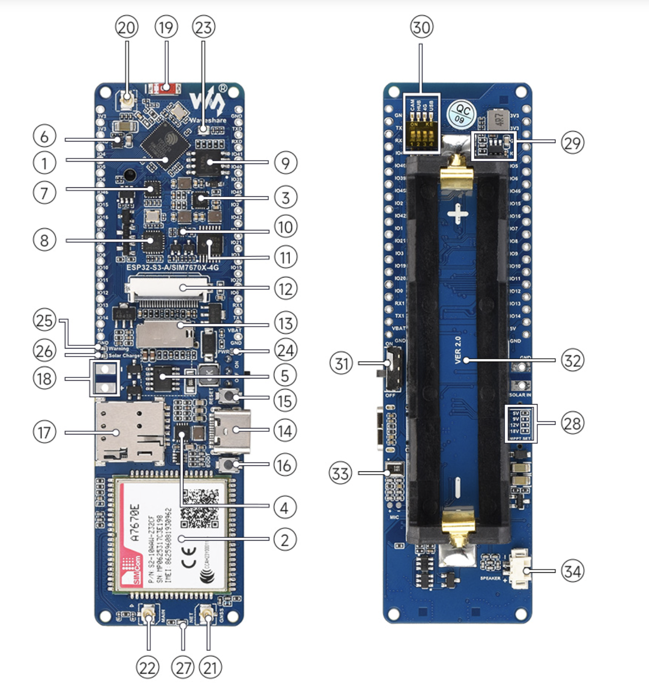
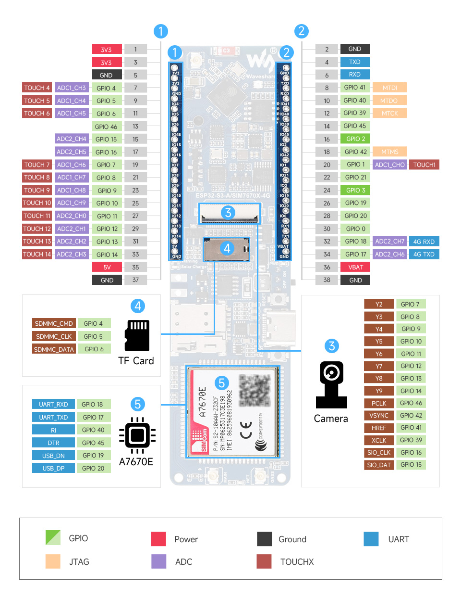
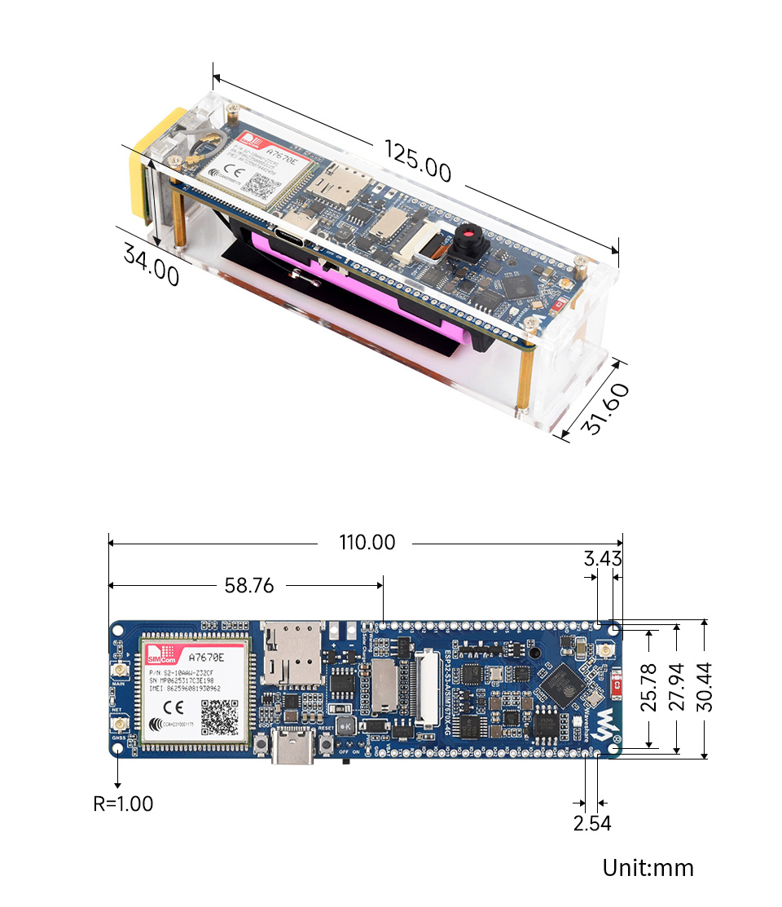

# 基于 ESP32-S3-A7670E-4G 的手持智能终端设计文档

> 目标：基于微雪 **ESP32-S3-A7670E-4G** 开发板，DIY 一台支持 **屏幕拨号通话、GNSS 定位、位置共享、拍照上传** 的手持设备。家人看的地图在手机或网页上显示；板载地图只做可选的小范围离线图。

`./images`下有**A7670E**的引脚图，接口图，尺寸图可以参考。

桌面、APP 生命周期、系统服务和任务管理器属于本需求的一部分，详细设计见 [手持终端桌面与 APP 架构设计](./superpowers/specs/2026-09-29-handheld-desktop-architecture-design.md)。需求与技术方案的风险核查和处置状态见 [需求与技术方案评审](./superpowers/specs/2026-09-29-requirements-architecture-review.md)。如本文与专项架构设计冲突，以本文确认的产品范围和硬件约束为准，技术实现细节以专项架构设计为准。

---
## 零、主板介绍

### 主板图


序号对照微雪官方板载资源，左图为正面，右图为背面。

1. **ESP32-S3R8**：主控。Xtensa 32 位 LX7 双核，最高 240MHz，内置 512KB SRAM、8MB PSRAM，支持 2.4GHz Wi-Fi 与蓝牙 LE。
2. **A7670E-FASE**：4G 模组。支持 LTE Cat-1、2G、语音通话、短信和 GNSS 定位。
3. **EA3036C**：三路 DC-DC，给主控和外围供电。
4. **ETA6098**：锂电池充电管理，负责 USB 充电。
5. **CN3791**：太阳能充电芯片。
6. **MAX17048G**：电池电压测量，用于读取电量。
7. **CH343**：USB 转 UART，用于下载程序和串口调试。
8. **CH334**：USB HUB，让同一个 Type-C 同时接 UART 和 USB。
9. **W25Q128JVSIQ**：外置 16MB Flash。
10. **FSUSB42UMX**：USB 切换芯片，配合拨码开关选择 A7670E 的 USB 接到电脑还是 ESP32-S3。
11. **TXB0104PWR**：电平转换，连接不同电压的信号。
12. **摄像头接口**：24PIN FPC，兼容 OV5640、OV2640 等。
13. **TF 卡槽**：存文件、图片或地图瓦片。
14. **USB Type-C**：下载、调试和供电。经 CH343、CH334 连接 ESP32-S3；也可由拨码开关切到 A7670E 的 USB，用于电脑拨号或模组调试。
15. **RESET**：复位按键。
16. **BOOT**：下载按键，进下载模式时按住。
17. **Nano SIM 卡槽**：插入运营商 Nano SIM。
18. **太阳能输入接口**：接 5V / 6V / 9V / 12V / 18V 太阳能板，电压档位由背面焊盘选择。
19. **板载陶瓷天线**：ESP32-S3 的 Wi-Fi / 蓝牙天线，默认使用。
20. **Wi-Fi 外接天线座（IPEX 1）**：默认走板载陶瓷天线；改焊盘后可接外置天线。
21. **GNSS 天线座（IPEX 1）**：接 GPS / 北斗 / GLONASS 天线。
22. **LTE 天线座（IPEX 1）**：接 4G 天线。
23. **WS2812B**：RGB 指示灯。
24. **电源指示灯**：蓝色，上电常亮。
25. **电池反接警告灯**：黄色，电池装反时亮。
26. **太阳能充电指示灯**：绿色，太阳能充电时亮。
27. **网络状态指示灯**：红色，入网后以约 200ms 间隔闪烁。
28. **太阳能输入电压选择焊盘**：默认 5V，可接 5.5V / 6V 太阳能板；改焊对应焊盘后可接 9V / 12V / 18V。
29. **SY8105IADC**：外部输入 DC-DC，把较高的外部电源降压后送入系统。
30. **拨码开关**（背面，共四路）：
    - **CAM**：摄像头供电，OFF 关闭摄像头。
    - **HUB**：USB HUB 驱动电路供电；用电池时拨到 OFF 可降低功耗。
    - **4G**：A7670E 供电，OFF 即关闭模组。
    - **USB**：A7670E 的 USB 通道。OFF 时电脑不能经 USB 访问模组，ESP32-S3 可走 USB 做热点。
31. **电池供电开关**：控制 18650 是否向板子供电。
32. **18650 电池座**：装单节 3.7V 锂电池，不随板附带。也可改用 VBAT 排针外接电池。
33. **麦克风接口**：通话拾音。
34. **扬声器接口**：通话放音，配套喇叭为 8Ω 2W。

### 接口图


### 尺寸图


---

## 一、系统总体架构

```
┌─────────────────────────────────────────────────────────┐
│                   ESP32-S3-A7670E-4G                    │
│  ┌─────────────┐  ┌─────────────┐  ┌─────────────────┐  │
│  │  ESP32-S3   │  │  A7670E 4G  │  │  GNSS 接收器    │  │
│  │  主控       │◄─┤  模组       │  │  (GPS/北斗)     │  │
│  │  240MHz     │  │  LTE Cat-1  │  │                 │  │
│  └──────┬──────┘  └──────┬──────┘  └────────┬────────┘  │
│         │                │                  │           │
│         │ UART           │ 4G天线           │ GNSS天线  │
│         ▼                ▼                  ▼           │
│  ┌─────────────┐  ┌─────────────┐  ┌─────────────────┐  │
│  │ 3.5寸 SPI   │  │ 麦克风/喇叭 │  │ 18650 锂电池    │  │
│  │ 触摸屏      │  │ 通话音频    │  │ + 电源管理      │  │
│  └─────────────┘  └─────────────┘  └─────────────────┘  │
│                                                         │
│  ┌─────────────┐  ┌─────────────┐  ┌─────────────────┐  │
│  │ OV5640      │  │ TF 卡       │  │ 拨码开关        │  │
│  │ 拍照上传    │  │ 照片/可选瓦片│  │ CAM/HUB/4G/USB  │  │
│  └─────────────┘  └─────────────┘  └─────────────────┘  │
└─────────────────────────────────────────────────────────┘
```

---

## 二、硬件采购清单

### 2.1 核心开发板

| 项目 | 型号 | 说明 | 参考价 |
| :--- | :--- | :--- | :--- |
| 主控板 | 微雪 ESP32-S3-A7670E-4G | 集成 ESP32-S3R8 + A7670E 4G + GNSS | 约 ¥234 |

**板载资源：**
- ESP32-S3R8：双核 240MHz，512KB SRAM，8MB PSRAM，16MB Flash
- A7670E：LTE Cat-1，支持语音通话、短信、4G 数传
- GNSS：GPS / 北斗 / GLONASS，IPEX1 天线接口
- 音频：麦克风接口 + 扬声器接口
- 摄像头：24PIN FPC 接口，兼容 OV2640 / OV3660 / OV5640
- 存储：TF 卡槽
- 电池：18650 电池座 + VBAT 排针，支持 USB / 太阳能充电。商品标题里的「18650 电池」和尺寸图里的粉色电芯都是示意，**电芯不在盒子里**
- 扩展：38PIN 排针，可配置 I2C / SPI / UART
- 其他：WS2812B RGB LED，拨码开关，USB Type-C

### 2.2 需要另买

| 外设 | 推荐型号 | 说明 | 参考价 |
| :--- | :--- | :--- | :--- |
| 屏幕 | 微雪 [3.5inch Capacitive Touch LCD](https://www.waveshare.com/3.5inch-capacitive-touch-lcd.htm) | 320×480，SPI（ST7796S）+ I2C 触摸（FT6336U）。模组 61.00 × 92.44mm。不要买 4.3 寸那款，那是 24 位 RGB，这块板接不上 | 约 ¥130 |
| 电池 | 18650 锂电池 | 3.7V，3000mAh 以上，带保护板，能承受 4G 发射时的电流脉冲。开发阶段可先用 USB 供电 | ¥30-50 |
| Nano SIM | 最终使用的运营商 SIM | 开通语音和数据。现有中国移动卡只用于基础链路预验证；上线前必须使用最终 SIM、套餐并在主要使用地区重新验证语音和数据。A7670E 的 LTE 频段是 B1/B3/B5/B7/B8/B20，移动缺 TDD，只有 B3/B8 | 自备 |
| TF 卡 | 8GB 起 | 存照片。做可选离线地图时再存瓦片。用开发板上的卡槽，不要用屏幕上那个 | ¥15-30 |

### 2.3 套装里已有，不用买

| 配件 | 接到哪里 |
| :--- | :--- |
| GNSS 陶瓷天线 | 主板 **21** 号 IPEX。板上 **19** 号陶瓷天线是 Wi-Fi / 蓝牙，不能用来定位 |
| FPC 4G 天线 | 主板 **22** 号 LTE IPEX。板子上没有板载 4G 天线 |
| 喇叭 | 8Ω 2W，插主板 **34** 号扬声器接口 |
| 麦克风 | 板载，直连 A7670E，只用于通话 |
| 摄像头 | 现货套装配 OV5640。背面丝印 VER 2.0 的就是这一版，拆箱核对，不要再买 OV2640 |
| 亚克力壳、排针、USB 线 | 主板接口为 38PIN，即两侧各 19 针。若配件是 40PIN 长排针，按实物裁成两条 1×19 后再焊接；屏幕线插在排针上。壳外宽只有 34mm，装不下 61mm 宽的屏 |
| 屏幕附带的 GH1.25 15PIN 线 | 一头插屏幕，另一头是 2.54mm 杜邦母头。不用再买杜邦线、USB 转 TTL，也不要买 2.0mm 排线 |

### 2.4 可选

| 外设 | 用途 | 参考价 |
| :--- | :--- | :--- |
| 外接 GNSS 天线 | 附带的陶瓷天线在室内锁不住星时再买 | ¥30-60 |
| 3D 打印外壳 | 屏幕盖在整机正面，不塞进电池仓。外壳内宽至少 61mm，总长仍约 125mm；屏长 92mm，多出来的约 30mm 留给天线或电池那一头 | 视设计而定 |
| 1000µF 电解电容 | 4G 发射时电池电压跌落再加，焊在 VBAT 与 GND 之间 | ¥2-5 |
| 散热片 | 4G 模组长时间连续发射时使用 | ¥5-10 |
| 1.75C 圆屏 | 已决定另买。家里看位置、照片和通话状态，不接到 4G 板上。见 4.7 节 | 另计 |

**总预算估算：约 ¥410 - ¥470**（开发板加屏幕、电池、TF 卡；不含 SIM 和外壳）

---

## 三、硬件连接方案

### 3.1 屏幕连接（避开摄像头）

可以同时接屏幕和摄像头。由于可用 GPIO 紧张，触摸与摄像头共用 GPIO15/16 上的 I2C/SCCB 控制总线；两者地址不同。`esp32-camera` 使用已经初始化的 I2C 端口，不重复安装总线驱动。该共享方案必须在硬件冒烟阶段验证触摸、摄像头初始化和拍照并发。

摄像头 FPC 在 VER 2.0 上固定占用这些脚，屏幕不能再用：

| 功能 | GPIO |
| :--- | :--- |
| 摄像头数据 Y2–Y9 | 7、8、9、10、11、12、13、14 |
| 摄像头与触摸共享 I2C/SCCB | 15（SDA）、16（SCL） |
| 摄像头同步和时钟 | 39（XCLK）、41（HREF）、42（VSYNC）、46（PCLK） |
| TF 卡 | 4（CMD）、5（CLK）、6（DATA） |
| 4G 串口 | 17（模组 TXD，ESP 接收）、18（模组 RXD，ESP 发送） |
| 4G USB | 19、20 |
| 4G DTR | 45（同时是启动配置脚） |

原先写的 GPIO8–12 就是摄像头数据线，那组接线作废。

先给主板两侧各焊一条 1×19 排针。若配件是 40PIN 长排针，先按实物裁切，不得把 20 针排针整体错位焊接。屏幕用附带的 15PIN 线，按下表把杜邦母头插到排针上。线序是屏幕 GH1.25 座的针号。

| 15PIN | 信号 | 接到 | 说明 |
| :--- | :--- | :--- | :--- |
| 1 | VCC | 5V | 模块可吃 3.3V 或 5V |
| 2 | 3V3 | 不接 | VCC 已供电 |
| 3 | GND | GND | 地 |
| 4 | MISO | 不接 | 只写屏，不读 |
| 5 | MOSI | GPIO1 | SPI 数据 |
| 6 | SCLK | GPIO2 | SPI 时钟 |
| 7 | SD_CS | 不接 | 屏幕上的 TF 卡座不用 |
| 8 | LCD_CS | GND | 片选常低。软件里片选设为 -1 |
| 9 | LCD_DC | GPIO21 | 数据/命令 |
| 10 | LCD_RST | 3.3V | 不占 GPIO |
| 11 | LCD_BL | 3.3V | 背光常亮 |
| 12 | TP_SDA | GPIO15 | 与 OV5640 的 SCCB 数据线共用统一 I2C 总线 |
| 13 | TP_SCL | GPIO16 | 与 OV5640 的 SCCB 时钟线共用统一 I2C 总线 |
| 14 | TP_INT | 不接 | 触摸用轮询 |
| 15 | TP_RST | 3.3V | 不占 GPIO |

GPIO0 保持空闲。它决定是正常启动还是进下载模式，不要拿去接屏幕。GPIO40 保留给板载 A7670 RI，不能再接触摸；即使软件不读取 RI，它与模组之间的板载电气连接仍然存在。

第一版 `LCD_BL` 固定接 3.3V，背光亮度不可软件调节，系统设置不提供亮度选项。屏幕原理图中的 `LCD_BL` 支持 GPIO/PWM 驱动，但当前功能组合没有已确认安全的空闲 GPIO，因此不为了调光占用启动脚或板载外设脚。`LCD_RST` 和 `TP_RST` 先采用固定高电平并验证软件复位；若真机无法从异常状态可靠恢复，再作为硬件 V2 增加复位控制。

### 3.2 摄像头连接

- 使用套装里的 **OV5640**，24PIN FPC 插入板载摄像头座。
- 金手指方向按座子丝印，插入后锁紧卡扣。
- 背面 **CAM** 拨到 ON 才给摄像头供电。正常运行时保持 ON，不拍照时优先让传感器软件休眠；共享触摸总线时不要频繁断电，避免摄像头经 I2C 线被反向供电。
- 软件按 VER 2.0 的引脚初始化，引脚见上一节，不要改成 V1 的 GPIO34–37。触摸先初始化统一 I2C 总线；相机配置将 `pin_sccb_sda` 和 `pin_sccb_scl` 设为 `-1`，通过 `sccb_i2c_port` 复用该总线。

### 3.3 电池与供电

- 盒子里只有电池座。尺寸图上的粉色圆柱是安装位置示意，电芯要另买。
- 18650 装入板载电池座，认准正负极。反接时 **25** 号黄色灯亮，有防反接保护。
- 也可以用 **VBAT** 排针外接其他 3.7V 锂电池。
- 背面 **31** 号电池开关拨到开，电池才向板子供电。
- **第一次装上电池后，要先接一次 USB 或外部电源。** 防反接保护需要这次上电才会激活，之后才能只用电池开机。
- 4G 发射时电流会冲到接近 2A。电池选 3000mAh 以上、放电能力足够的电芯。电压被拉低时，在 VBAT 与 GND 之间加 **1000µF**。
- 官方实测：连续拍照或录像大约 1.8A、约 9W，2600mAh 电池只能撑约 1.5 小时。本机以通话、定位、偶尔拍照为主，续航会长一些，但不要按待机去估。
- 用电池时把 **HUB** 拨到 OFF，关掉 USB HUB 供电。

### 3.4 音频连接

- 麦克风是板载的，直接连到 A7670E，不用再买麦克风模块。
- 喇叭用配件里的 **8Ω 2W**，插 **34** 号接口。
- 这两路只进 A7670E，不进 ESP32。通话不用配 I2S，也不用外加编解码器。回声消除在模组里。

### 3.5 天线连接

- **4G**：配件里的 FPC 天线接 **22** 号 LTE IPEX。
- **GNSS**：配件里的陶瓷天线接 **21** 号 IPEX。天线面朝天空，远离电池和金属。
- **Wi-Fi / 蓝牙**：用 **19** 号板载陶瓷天线，不用另接。
- 室内搜星不稳定。冷启动后在窗边或室外等大约 1 分钟。

### 3.6 拨码开关

背面一共四路，不要拆掉。本机推荐：

| 开关 | 状态 | 说明 |
| :--- | :--- | :--- |
| 4G | **ON** | 给 A7670E 供电。OFF 后模组关机，再拨 ON 会重启模组 |
| USB | **OFF（正常运行候选）** | A7670E USB 接 ESP32-S3；阶段 0 先用 ESP-IDF USB Host 枚举实际接口并验证 CDC-ACM/PPP 数据路径。需要从电脑直接调试模组 USB 时再切换 |
| CAM | **ON（正常运行）** | 摄像头与触摸共享控制总线，不拍照时使用软件休眠 |
| HUB | 电池供电时 **OFF** | 关掉 USB HUB，降低功耗 |

拨码只切换供电和 USB 通道，不妨碍屏幕拨号。

---

## 四、软件开发路线

### 4.1 开发环境

- **框架**：ESP-IDF v5.5.5
- **图形库**：LVGL v9.6.0
  + https://lvgl.io/docs/open
  + https://lvgl.github.io/open-docs/HTML/9.3/intro/introduction.html
  + https://github.com/lvgl/lvgl
- **屏幕驱动**：`esp_lcd` 组件
- **地图**：阶段三只在屏幕上显示坐标。板载瓦片地图是可选项，用到时再加乐鑫 `map_tiles`
- **摄像头**：`esp32-camera` v2.1.8，传感器选 OV5640
- **4G 控制**：UART + AT 指令，由唯一 `Modem Manager` 独占
- **4G 数据**：优先验证 A7670E USB Host + CDC-ACM/PPP，照片和普通 HTTPS 请求不走 115200 UART。该路径必须在阶段 0 根据实际 USB descriptors 和模组数据接口验证后才能定版

其他组件在创建固件项目时选择与上述版本兼容的明确版本，并提交 `dependencies.lock`、组件清单和验证过的 `sdkconfig.defaults`，不使用无上限的浮动版本。

### 4.2 阶段一：点亮屏幕，跑通 LVGL

1. 在 ESP-IDF 中创建新项目。
2. 添加 `esp_lcd` 组件，配置 SPI 屏幕参数（分辨率、颜色格式、SPI 频率）。
3. 添加 LVGL 组件，初始化显示缓冲区和触摸输入。
4. 显示一个简单的“Hello World”界面，确认屏幕和触摸正常工作。

SPI 用 3.1 节的引脚：SCLK = GPIO2，MOSI = GPIO1，DC = GPIO21，片选设为 -1。LVGL 9 的显示注册接口和 LVGL 8 不同，按 LVGL 9 文档初始化。

### 4.3 阶段二：桌面内核与 APP 管理

本阶段先建立后续 APP 共用的桌面系统，不直接把拨号页作为开机首页。完整规则见 [手持终端桌面与 APP 架构设计](./superpowers/specs/2026-09-29-handheld-desktop-architecture-design.md)。

1. 实现固定布局的多页桌面，首批内置电话、相机、相册和系统设置。
2. 实现 `AppRegistry`、`Page Manager`、APP 页面栈和统一生命周期。
3. 实现底部返回桌面手势、上划最近任务和任务卡关闭。
4. LVGL 只能由 UI Task 调用；相机、TF、网络和 AT 等阻塞操作不得进入 UI 回调。
5. 最近任务最多四项，后台页面先保守缓存一个；完成内存基准后再决定是否提高到两个。
6. 系统设置提供“资源监控”页，显示内部 SRAM、PSRAM 的总量、剩余量、历史最低值和最大连续块，以及 Flash/NVS/TF 使用量、页面和快照占用、任务栈余量与关键队列深度。页面前台时每秒刷新，离开后停止刷新。

### 4.4 阶段三：电话服务与拨号 APP

1. **UI 设计**：在 LVGL 中创建一个数字键盘界面，包含：
   - 号码显示区
   - 0-9 数字按键
   - 拨号键、挂断键、删除键

2. **UART 通信**：波特率 115200。接口图上模组 **TXD 在 GPIO17**，模组 **RXD 在 GPIO18**。ESP32-S3 从 GPIO17 接收，从 GPIO18 发送。UART 只能由 `Modem Manager` 访问，电话、GNSS 和网络状态服务只能向它提交结构化请求。

3. **AT 指令拨号**（A7670，分号不能省）：
   ```
   ATD13800138000;    // 语音拨号
   ATA                // 接听
   AT+CHUP            // 挂断
   ```
  来电时串口会出现 `RING`，GPIO40 的板载 RI 连接也保留。`Modem Manager` 将命令响应和 `RING`、`NO CARRIER` 等异步 URC 分流，通话控制优先级高于 GNSS 查询和普通上传。

4. **音频通路**：板载麦克风和配件喇叭都已接到 A7670E。拨通后声音不经过 ESP32。

**拨号函数示例：**
```c
void dial_number(const char *number) {
    char cmd[32];
    snprintf(cmd, sizeof(cmd), "ATD%s;\r\n", number);
    uart_write_bytes(UART_NUM_1, cmd, strlen(cmd));
}
```

示例仅表示 AT 命令格式，正式 APP 不得直接调用 `uart_write_bytes`，必须经过 `Modem Manager`。

电话状态分两层管理：

- 模组可用性：`Off`、`Booting`、`Registering`、`Ready`、`Error`。
- 呼叫状态：`Idle`、`Incoming`、`Dialing`、`Alerting`、`Active`、`Ending`、`Failed`。

失败原因单独记录忙线、拒接、无人接听、无服务、对方挂断、网络中断和 AT 命令错误。关闭电话 APP 的 UI 不能中断正在进行的通话。

现有中国移动卡可用于基础链路预验证，包括真实呼出、呼入、接听、双方挂断和通话期间数据连接；它不是最终用卡，因此上线前还必须使用最终运营商、套餐并在主要使用地区重新验证网络注册、IMS/VoLTE、语音和数据并发。

### 4.5 阶段四：GNSS 定位，屏幕显示坐标

这一阶段不显示地图。屏幕上给出定位状态、十进制度坐标、卫星数和时间。家人看的地图放在阶段四的手机或网页上。

1. **打开 GNSS，等模组就绪**（A76XX 指令，不要用 SIM7600 的那套）：
   ```
   AT+CGNSSPWR=1
   ```
   等到返回 `+CGNSSPWR: READY!` 再查询。没定位时字段是空的。室外冷启动大约 1 分钟。

2. **读取定位**：
   ```
   AT+CGNSSINFO
   ```
   返回示例：
   ```
   +CGNSSINFO: 2,09,05,00,3113.330650,N,12121.262554,E,131117,091918.0,32.9,0.0,255.0,1.1,0.8,0.7
   ```
   字段依次是：定位模式（2=2D，3=3D）、GPS 卫星数、GLONASS 卫星数、北斗卫星数、纬度、南北、经度、东西、日期 `ddmmyy`、UTC 时间、海拔（米）、地速（节）、航向。

3. **先换成十进制度，再显示或上传。** 模组给的是 `ddmm.mmmm`，不是小数度。
   ```
   3113.330650,N → 31 + 13.330650 / 60 = 31.2221775
   12121.262554,E → 121 + 21.262554 / 60 = 121.354376
   ```
   南纬、西经取负。

定位服务使用以下内部状态，界面显示对应中文，不直接暴露英文枚举：

- `Disabled`：用户关闭定位。
- `Starting`：GNSS 正在启动。
- `NoFix`：GNSS 正常但尚未获得定位。
- `Fixed`：获得满足新鲜度要求的新位置。
- `Stale`：只有超过新鲜度阈值的最后位置。
- `Error`：模组、命令或解析发生故障。

每个位置样本携带样本 ID、定位时间、接收时间和卫星信息。失锁后允许保留最后坐标，但必须显示“上次位置”和距今时间，不能把它冒充当前位置。

#### 板载地图（可选，不阻塞阶段三）

主地图不放在这块屏上。若以后仍要在设备上看到底图，范围收成常活动的一个城市，只做缩放 **13–16** 四级，瓦片为 RGB565、256×256，放在 TF 卡 `/sdcard/tiles/{z}/{x}/{y}.bin`。不要做全球 0–19 级。瓦片坐标用上面的十进制度去换算。乐鑫 `map_tiles` 可以参考，但它的示例板不是这块板，引脚和屏幕驱动要按 3.1 节改。

### 4.6 阶段五：位置共享给家人

#### 方案 A：4G 上传到云平台（推荐）

- 上传的是十进制度，不是 `ddmm.mmmm`。
- ESP32-S3 优先通过 GPIO19/20 上的 A7670E USB 建立数据连接，再使用 ESP-IDF HTTPS 客户端上传。ESP32-S3 在该连接中是 USB Host，阶段 0 必须先确认 A7670E 暴露的 USB descriptors、CDC-ACM 数据接口以及接入 PPP/netif 的方式。GPIO17/18 UART 保留给 AT 控制和 URC，不承载照片正文。
- 家人在手机或网页上用地图 API 看位置。这是本机的主地图。

**上传流程：**
```
AT+CGNSSINFO → 换成十进制度 → ESP32 组 JSON → 经阶段 0 验证的数据链路 + HTTPS POST → 云端保存 → 家人打开地图
```

没有新定位时，设备仍上报在线状态和定位状态；服务器保留最后已知位置并显示更新时间，但不更新“当前位置”的时间。上传失败采用有上限的指数退避，服务端按位置样本 ID 去重。

第一版云端只服务一个家庭，并满足以下最小安全要求：

- 设备只主动发起 HTTPS 连接，不开放公网入站端口，并校验服务端证书。
- 每台设备使用独立随机凭据，凭据保存到启用加密的 NVS；凭据可吊销和轮换。
- 家属访问位置和照片必须认证；照片使用鉴权接口或短时授权 URL。
- 远程命令包含唯一 ID、创建时间、过期时间，只能消费一次，并返回执行结果。
- 服务端限制位置、照片、命令和日志的保存期限，不在日志中记录凭据或完整敏感数据。

#### 方案 B：通过手机 App 中转（BLE）

- 手表通过 **BLE** 连接家长手机 App。
- App 负责上传位置和接收指令。
- 适合家长手机始终在身边的情况。

#### 方案 C：LoRa 远距离共享（如果家长也在附近）

- 如果手里有另一块带 LoRa 的板子，可以通过 LoRa 直接发送 GPS 坐标。
- 无需依赖蜂窝网络，适合户外无信号场景。

### 4.7 阶段六：拍照并经 4G 上传

不做实时视频通话。Cat-1 上行理论 5Mbps，实际更低，ESP32-S3 也扛不住双向视频编解码。微雪没有这块板的 4G 远程视频例程。

1. **CAM 拨到 ON**，用套装 OV5640 和 `esp32-camera`，引脚按 3.1 节的 VER 2.0 表填写。
2. 先在本机屏幕上看到预览，再直接采集 JPEG。第一版默认 VGA，单张上限 200KB；超限时降低 JPEG 质量或分辨率重拍。
3. 照片先写入 TF 卡并归还相机帧缓冲，再由 Network Worker 以 8–16KB 分块通过阶段 0 验证的数据链路执行 HTTPS POST，避免整张照片长期占用相机缓冲。
4. HTTP POST 只是应用协议，图片字节仍要完整传输；优先验证 USB Host + CDC-ACM/PPP 是为了绕开 115200 UART 约 11.5KB/s 的有效载荷上限。若 A7670 的实际 USB 接口无法稳定接入 PPP，则必须回到架构评审，比较模组可支持的高速 UART 或其他数据接口，不能假定上传达到数秒级。
5. 来电或挂断事件优先于照片上传；上传可暂停或取消，并采用有上限的退避重试。
6. 拍照时电流大约 1.8A。正常运行时 CAM 保持 ON，不拍照时让传感器软件休眠。

### 4.8 配套圆屏：1.75C（不接线）

另买一块 [ESP32-S3-Touch-AMOLED-1.75C](https://www.waveshare.com/esp32-s3-touch-amoled-1.75c.htm)，放在家里或随身挂着。它是一块自带 ESP32-S3 的圆屏整机，466×466 AMOLED，铝合金壳。屏焊在它自己的主控上，不能拆下来接到 4G 板。两台不连排针。

1.75C 只有 Wi-Fi 和蓝牙，没有 4G。人出门之后，它够不到 4G 板的蓝牙。

出门之后的推荐做法是中间服务，两台都不直连：

1. 4G 板用蜂窝把定位、通话状态、照片 POST 到你的服务器。
2. 服务器只保存最新一份：十进制度、电量、时间、通话状态（号码、拨号中/通话中/已挂断）、最新一张 JPEG。
3. 1.75C 用家里的 Wi-Fi 轮询这份数据。定位和通话状态每 2–5 秒拉一次 JSON 就够。照片只在「有新照片」时再下载，不要每次把整张 JPEG 拉下来。

摇一摇、点一下要 4G 板立刻再报位置或再拍照时，圆屏向服务写入带唯一 ID 和过期时间的指令，4G 板下一次轮询时取走；同一指令只能执行一次，并将结果回传。这样仍然只有这一个服务。

近距离的蓝牙和 ESP-NOW 可以后做。人出门之后，没有这个服务和两边的网络，圆屏收不到数据。

三个玩法都读这个服务：

1. **定位牌。** 圆屏显示几分钟前更新、剩余电量、离家多远。
2. **圆形照片。** 圆屏取最新一张 JPEG，裁成圆图。1.75C 没有 TF 卡，只留最新一张。
3. **摇一下就回报。** 圆屏摇一下或点一下，往服务写一条指令，4G 板再报一次位置或再拍一张。

通话状态跟着定位一起轮询：拨号、通话中、已挂断、号码和计时。接听和挂断仍在 4G 板的 3.5 寸屏上完成。

---

## 五、关键注意事项与避坑指南

### 5.1 GPIO

屏幕接线以 3.1 节为准。GPIO15/16 由触摸和 OV5640 共用统一 I2C/SCCB 总线；GPIO40 保留给 A7670 RI；GPIO0 不要占用。GPIO3、GPIO45、GPIO46 属于启动绑带脚，其中 GPIO45/46 是开发板既定连接，不新增外接负载。

最终装配状态下必须完成至少 50 次断电冷启动、50 次 RESET 热重启、USB 下载模式进入和退出测试，并覆盖 4G、摄像头、屏幕同时上电以及不同拨码状态。测试通过前，引脚方案不标记为最终定版。

### 5.2 供电

细节见 3.3 和 3.6。记这四条：

- 电池第一次装上后，先接一次 USB，防反接保护才会激活。
- 电池供电时 **HUB = OFF**，**4G = ON**，**USB = OFF**。
- 电池开关（主板 31）要打开。反接时黄灯亮。
- 4G 发射电流大。3000mAh 起，电压不稳再在 VBAT/GND 加 1000µF。

### 5.3 天线

4G 和 GNSS 用配件里的两根天线，分别接 22 号和 21 号。19 号板载天线只服务 Wi-Fi / 蓝牙。室内定位到窗边或室外测。

### 5.4 地图

阶段三只显示坐标。家人看的地图在手机或网页上。板载瓦片如果要做，只做一个城市的 13–16 级，格式 RGB565、256×256。坐标先从 `ddmm.mmmm` 转成十进制度。

### 5.5 音频

通话音频在 A7670E 上，不在 ESP32 上。不用为拨号去配 I2S 或编解码器。先确认配件喇叭已插上、板载麦克风没有被外壳堵住。

---

## 六、开发里程碑

| 阶段 | 目标 | 预计时间 |
| :--- | :--- | :--- |
| 0 | 硬件冒烟：屏幕/触摸/相机共享总线、最终接线启动稳定性、临时移动卡语音预验证、USB Host 数据链路探针 | 1-2 周 |
| 1 | 桌面内核：分页、APP 生命周期、最近任务、快照降级和资源监控 | 2-3 周 |
| 2 | 电话集成：Modem Manager、真实呼入呼出、覆盖层和异常状态 | 2-3 周 |
| 3 | 相机与相册：预览、拍照、TF 存储、JPEG 解码和内存基准 | 2-3 周 |
| 4 | 定位与云端：GNSS 状态、已验证数据链路、HTTPS、安全和家属地图 | 2-3 周 |
| 5 | 整机稳定性：并发压力、两小时运行、断网、队列拥堵和内存故障注入 | 1-2 周 |
| 6 | 外壳设计与组装 | 1-2 周 |
| 7 | 1.75C 圆屏：定位牌、最新照片、一次性远程指令 | 4G 板主线跑通后再做 |

---

## 七、参考资源

- 微雪 ESP32-S3-A7670E-4G 产品页：  
  https://www.waveshare.net/shop/ESP32-S3-A7670E-4G.htm
- A76XX GNSS 应用笔记（`AT+CGNSSPWR` / `AT+CGNSSINFO`）：  
  https://files.waveshare.com/wiki/A7670E-Cat-1-GNSS-HAT/A76XX_Series_GNSS_Application_Note_V1.03.pdf
- 微雪 ESP32-S3-A7670E-4G 文档：  
  https://docs.waveshare.com/ESP32-S3-A7670E-4G
- 配套圆屏 ESP32-S3-Touch-AMOLED-1.75C：  
  https://www.waveshare.com/esp32-s3-touch-amoled-1.75c.htm
- LVGL 官方文档：  
  https://docs.lvgl.io/
- ESP-IDF 编程指南：  
  https://docs.espressif.com/projects/esp-idf/zh_CN/latest/esp32s3/
- 手持终端桌面与 APP 架构设计：  
  [./superpowers/specs/2026-09-29-handheld-desktop-architecture-design.md](./superpowers/specs/2026-09-29-handheld-desktop-architecture-design.md)
- 需求与技术方案评审及处置状态：  
  [./superpowers/specs/2026-09-29-requirements-architecture-review.md](./superpowers/specs/2026-09-29-requirements-architecture-review.md)

---

## 八、总结

本设计基于 **ESP32-S3-A7670E-4G**。套装已含 GNSS 天线、4G 天线、喇叭、麦克风、OV5640 和排针。屏幕用微雪 3.5inch Capacitive Touch LCD，附带的 15PIN 线直接插排针，不用另买杜邦线。需要另买的是 **这块屏幕、18650 电芯、Nano SIM、TF 卡**。

屏幕避开摄像头引脚，接在 GPIO1、GPIO2、GPIO21、GPIO40、GPIO3 上。定位用 `AT+CGNSSINFO`，拨号用 `ATD号码;` 和 `AT+CHUP`。地图主要给家人在手机上看。摄像头用来拍照上传，不做视频通话。

另有一块 1.75C 圆屏，不和 4G 板接线。近距离用蓝牙或 ESP-NOW；人出门后，4G 板走蜂窝、圆屏走家里的 Wi-Fi，订同一份位置和照片。

开发顺序：**点亮屏幕 → 屏幕拨号 → 屏幕显示坐标 → 位置上传 → 拍照上传 → 外壳 → 圆屏联动**。

> 本文档为设计方案，具体引脚、参数和代码实现请以微雪官方文档和实际硬件为准。